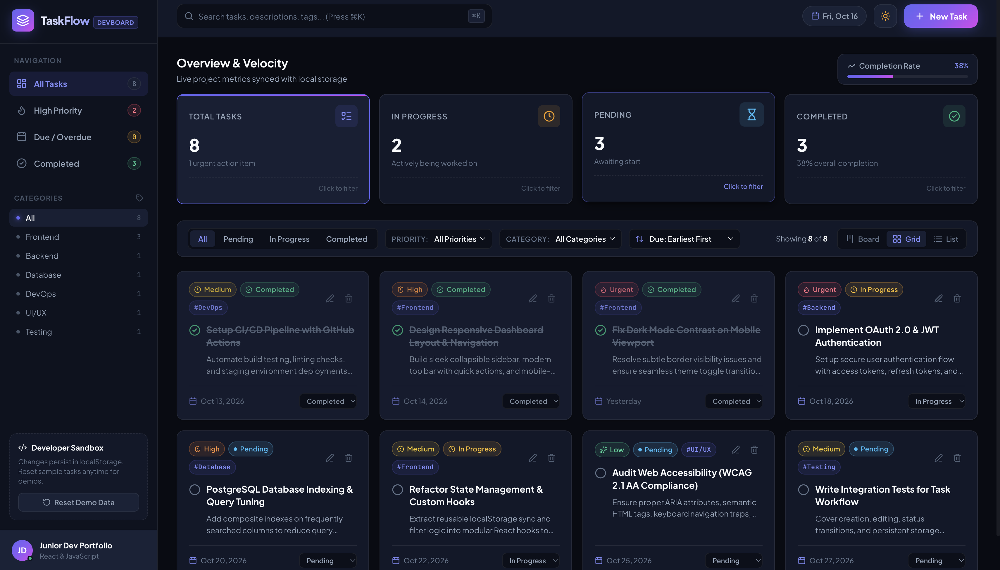

# ⚡ TaskFlow — Developer Task Management Dashboard

A modern, high-performance, and responsive **Task Management Dashboard** built with **React**, **Vite**, and pure **Vanilla CSS**. Designed as a portfolio-ready showcase project for software developer resumes and technical interviews.


---

## 🌟 Project Highlights & Live Features

- **📊 Comprehensive Project Analytics**:
  - Live metric cards: **Total Tasks**, **In Progress**, **Pending**, and **Completed**.
  - Dynamic **Productivity & Velocity Progress Bar** showing real-time sprint completion percentage.
  - Interactive cards: Click any stat card to instantly filter tasks by that status.

- **🗂️ Dual View Modes (Board & Grid/List)**:
  - **Kanban Board View**: 3 workflow columns (*Pending*, *In Progress*, *Completed*) with fast lane-advancing buttons.
  - **Grid Cards View**: Elegant responsive card grid with quick status selectors and action menus.
  - **Compact List View**: Dense single-row view ideal for rapid scanning and bulk review.

- **⚡ Full Task Lifecycle (CRUD)**:
  - **Create**: Modal dialog with title validation, optional rich description, priority, status, category, and due date.
  - **Read**: Quick scan with color-coded priority and status pills, category tags, and relative date calculations.
  - **Update**: Edit any task in-place with pre-filled inputs and instant state updates.
  - **Delete**: Protected by a confirmation modal to prevent accidental data loss.
  - **Complete**: One-click completion toggle with celebratory confetti particles (`canvas-confetti`).

- **🔍 Real-Time Search & Multi-Criteria Filtering**:
  - Instant search across task titles, descriptions, and category tags.
  - Filter by **Status** (*All*, *Pending*, *In Progress*, *Completed*).
  - Filter by **Priority** (*All*, *Urgent*, *High*, *Medium*, *Low*).
  - Filter by **Category** (*Frontend*, *Backend*, *Database*, *DevOps*, *UI/UX*, *Testing*).
  - Sort by:
    - Due Date (Earliest First)
    - Due Date (Latest First)
    - Priority (Urgent & High First)
    - Date Created (Newest First)
    - Title (A to Z)

- **💾 Browser Persistence (`localStorage`)**:
  - Automatically preserves all tasks, edits, and deletions across page refreshes.
  - Includes realistic developer sample tasks out of the box for instant demoing.
  - Includes a one-click **"Reset Demo Data"** button to restore sample tasks at any time.

- **🌓 Dark & Light Mode Support**:
  - Sleek dark theme by default with deep navy slate surfaces and vibrant indigo/violet accents.
  - Clean light theme with crisp contrast and soft borders.
  - Persists user theme preference in `localStorage`.

- **⌨️ Keyboard Shortcuts & Micro-Interactions**:
  - Press `⌘K` or `Ctrl+K` (or `/`) anywhere to focus the search bar.
  - Press `Esc` to instantly close modals.
  - Polished hover effects, micro-animations, and slide-in toast notifications.

---

## 🛠️ Tech Stack & Architecture

| Technology | Purpose | Why It Was Chosen |
| :--- | :--- | :--- |
| **React 18+** | Frontend UI Framework | Declarative component model, state hooks, and virtual DOM |
| **Vite** | Build Tool & Dev Server | Sub-millisecond HMR, lightning-fast compilation, modern ES modules |
| **Vanilla CSS** | Styling & Design System | Zero CSS bundle overhead, full customizability with CSS variables |
| **Lucide React** | Icons | Crisp, lightweight, modern SVG icons |
| **Canvas Confetti** | Visual Polish | Micro-interaction celebration when tasks are marked complete |
| **Web Storage API** | Client-Side Persistence | Zero backend required, instant offline-capable data persistence |

---

## 📁 Project Directory Structure

```text
TaskManagementDashboard/
├── public/                     # Static public assets
│   └── favicon.svg             # Custom task checklist SVG favicon
├── src/
│   ├── assets/                 # Images and media
│   ├── components/
│   │   ├── Common/             # Reusable UI primitives
│   │   │   ├── Badge.jsx       # Priority, Status & Category badge chips
│   │   │   ├── Badge.css
│   │   │   ├── Toast.jsx       # Slide-in toast notification alerts
│   │   │   └── Toast.css
│   │   ├── Filters/
│   │   │   ├── FilterBar.jsx   # Status tabs, dropdowns & view switchers
│   │   │   └── FilterBar.css
│   │   ├── Header/
│   │   │   ├── Header.jsx      # Top navigation, search & theme toggle
│   │   │   └── Header.css
│   │   ├── Modals/
│   │   │   ├── TaskModal.jsx   # Create & Edit task dialog
│   │   │   ├── TaskModal.css
│   │   │   ├── ConfirmModal.jsx# Delete confirmation alert dialog
│   │   │   └── ConfirmModal.css
│   │   ├── Sidebar/
│   │   │   ├── Sidebar.jsx     # Navigation views, categories & developer card
│   │   │   └── Sidebar.css
│   │   ├── Stats/
│   │   │   ├── StatCards.jsx   # 4 metric cards + velocity progress bar
│   │   │   └── StatCards.css
│   │   └── Tasks/
│   │       ├── TaskCard.jsx    # Individual task card (grid & list variants)
│   │       ├── TaskCard.css
│   │       ├── TaskList.jsx    # Task list container & empty states
│   │       ├── TaskList.css
│   │       ├── TaskBoard.jsx   # 3-column Kanban board with lane movers
│   │       └── TaskBoard.css
│   ├── data/
│   │   └── initialTasks.js     # Realistic engineering sample tasks
│   ├── hooks/
│   │   ├── useLocalStorage.js  # Generic state-to-localStorage sync hook
│   │   └── useTheme.js         # Theme toggle & HTML attribute manager
│   ├── utils/
│   │   └── dateUtils.js        # Relative dates, overdue checks & ID generation
│   ├── App.jsx                 # Central application state orchestrator
│   ├── App.css                 # Main layout and responsive container
│   ├── index.css               # Global CSS tokens, reset & color themes
│   └── main.jsx                # React DOM root entry point
├── index.html                  # HTML5 template with Google Fonts & metadata
├── package.json                # Project dependencies and npm scripts
├── vite.config.js              # Vite bundler configuration
└── README.md                   # Complete documentation & interview guide
```

---

## 🚀 Beginner-Friendly Step-by-Step Guide for macOS (MacBook Air M2)

Follow these simple steps in your Mac's **Terminal** app:

### Step 1: Open Terminal & Navigate to Project
1. Press `Cmd + Space` to open **Spotlight Search**.
2. Type `Terminal` and press `Return`.
3. Enter the project folder:
   ```bash
   cd ~/Desktop/TaskManagementDashboard
   ```

### Step 2: Verify Node.js Installation
Make sure Node.js (v18 or higher) is installed:
```bash
node -v
npm -v
```
*(If Node.js is not installed, download the macOS installer from [nodejs.org](https://nodejs.org/)).*

### Step 3: Install Dependencies
If you ever download or clone this project fresh:
```bash
npm install
```

### Step 4: Start the Development Server
Run the following command:
```bash
npm run dev
```

You will see:
```text
  VITE v8.x.x  ready in 180 ms

  ➜  Local:   http://localhost:5173/
  ➜  Network: use --host to expose
```

### Step 5: View the Application
Open **Safari**, **Google Chrome**, or your preferred browser and visit:
👉 **[http://localhost:5173/](http://localhost:5173/)**

### Step 6: Test the Production Build
To test that the application bundles cleanly with zero build errors:
```bash
npm run build
```

---

## 📸 How to Take Screenshots for Your Resume & Portfolio

To showcase this project on your LinkedIn, GitHub profile, or portfolio website:

1. **Mac Screenshot Shortcuts**:
   - `Cmd + Shift + 4` -> Drag to capture a clean rectangle of any card or modal.
   - `Cmd + Shift + 4` then press `Spacebar` -> Click the browser window to capture a clean drop-shadow screenshot.
   - `Cmd + Shift + 5` -> Screen recording for a short 10-second demo GIF.

2. **Recommended Screenshots to Capture**:
   - **Screenshot 1 (Hero)**: Overview in **Dark Mode** showing the metric cards, sidebar, and task cards.
   - **Screenshot 2 (Kanban View)**: Switch to **Board View** showing the three workflow lanes (*Pending*, *In Progress*, *Completed*).
   - **Screenshot 3 (Create/Edit Modal)**: Click *New Task* to capture the clean modal with focus ring and validation.
   - **Screenshot 4 (Celebration Effect)**: Click the circle checkmark on a task to capture the confetti celebration.

---

## 🎯 Technical Interview Preparation & Talking Points

When an interviewer asks you about this project, use these key points:

### 1. How did you manage state without Redux?
> *"For a client-side dashboard of this scope, I applied the principle of **Lifting State Up** to `App.jsx`. I built a custom `useLocalStorage` hook that synchronizes React state with the browser's storage API seamlessly. For derived state (like filtering by status, search queries, and sorting), I utilized `useMemo` so calculations only execute when the tasks or filter parameters change, preventing unnecessary re-renders."*

### 2. How does the `useLocalStorage` custom hook work?
> *"The hook encapsulates `useState` with a lazy initializer function that reads and parses JSON from `window.localStorage`. It uses `useEffect` to write updates back whenever the key or value changes, with `try/catch` safety blocks to handle private browsing quotas or malformed JSON gracefully."*

### 3. Why Vanilla CSS instead of Tailwind or component libraries?
> *"I chose Vanilla CSS with modern **CSS Custom Properties (Variables)** to demonstrate a strong foundational command of CSS, responsive design, Flexbox, and CSS Grid. It allowed me to implement a complete design system with dark and light themes, smooth transitions, and glassmorphism without adding heavy third-party CSS dependencies."*

### 4. How did you ensure accessibility and performance?
> *"The dashboard uses semantic HTML elements (`<header>`, `<aside>`, `<main>`, `<nav>`), ARIA labels for icon-only buttons, keyboard shortcuts (`⌘K` to focus search, `Esc` to close dialogs), and WCAG-compliant color contrast ratios across both dark and light themes."*

---

## 📄 License

This project is open-source and available under the **MIT License**. Feel free to customize and feature it on your software engineering portfolio!
